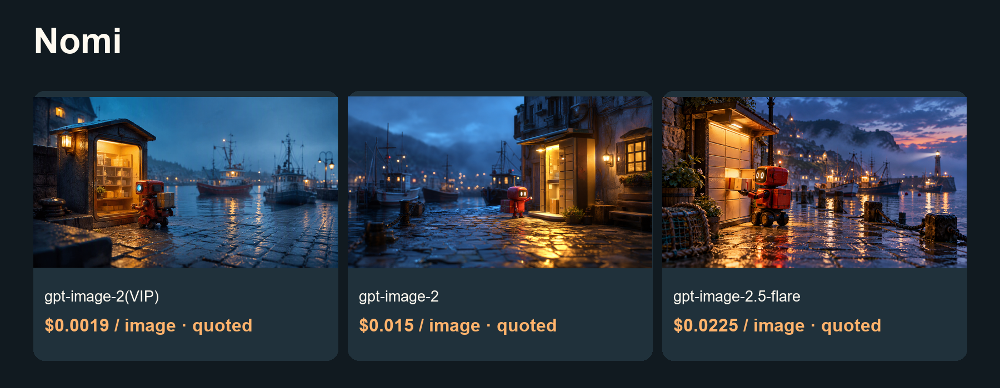
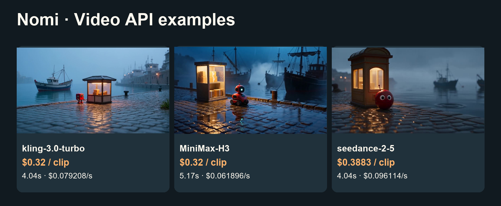

# Lower-cost Nomi image and video guide

Local-first storyboards, model connections and a video timeline.

[中文](README_zh-CN.md) · [Model & pricing](https://go2v.toapis.com/1020_nm_g) · [Upstream](https://github.com/aqm857886159/Nomi)

**Independent ToAPIs community guide, not an upstream-endorsed edition.** This validates API cases and configuration/module boundaries; full upstream product acceptance is pending.

## Demo



[](examples/seedance-2-mini.mp4)

[▶ Open the original video](examples/seedance-2-mini.mp4)

Video parameters: seedance-2-mini · 480p · 4s requested / 4.04s decoded · 16:9 · generate_audio=false · first-frame I2V.

Confirmed video cost: $0.13338 / clip · $0.03301485148514851485148514851/s (this case).

## Case amounts and model rates (ascending)

2026-10-20.

| Model / preset | Type | Case amount / quote | Applicable model rate | Fee evidence |
|---|---|---:|---|---|
| gpt-image-2(VIP)<br>low / 1K | image | Quoted $0.0019 | $0.0019/image | Configured rate; task billing unavailable |
| gpt-image-2<br>1K | image | Quoted $0.015 | $0.015/image | Configured rate; task billing unavailable |
| gpt-image-2.5-flare<br>high / 1K | image | Quoted $0.0225 | $0.0225/image | Configured rate; task billing unavailable |
| seedance-2-mini<br>480p / 4.04s / no audio | video | $0.13338 | $3.285714/1M total tokens | API billing=settled |

gpt-image-2(VIP) starts at $0.0019/image; this low/1K case is $0.0019/image. Images retain quote labels when task billing is unavailable. Three image models use the same project prompt with different quality presets. Video USD/s is a measured case ratio, not a fixed tariff.

## Project-specific reuse

1. Use the normal Model Connection UI to create a ToAPIs connection; origin https://toapis.com, Bearer authentication, private generation key.
2. Supply integration/nomi-supplied-contract.json through the supported Agent/UI adapter-contract path. The provider identity is supplied by Nomi; do not write catalog.json or credentials by a side channel.
3. The supplied contract and the complete draft passed the pinned upstream validator for 3 image models and one first-frame video model. This is schema/semantic evidence, not desktop certification.
4. Use the image upload declaration for local first frames, then explicit async create/query mappings. Complete native certification and a real canvas task before treating the connection as production-ready.

## Run the independent API cases

```powershell
$env:TOAPIS_API_KEY="your_private_key"
python run_case.py --job jobs/gpt-image-2-vip.json
python run_case.py --job jobs/gpt-image-2-vip.json --live
python run_case.py --job jobs/video.json
python run_case.py --job jobs/video.json --live
```

Without --live, only the current key rate is queried. Set a budget locally; the recipe enforces per-request caps, not a hosted-account global spend limit. After errors/timeouts, reconcile the saved task before another submission.

## Optional synchronous compatibility bridge

```powershell
$env:BRIDGE_TOKEN="replace_with_a_separate_random_token_at_least_24_chars"
$env:BRIDGE_PORT="8769"
python bridge.py
```

Binds to 127.0.0.1 only. UI credentials use the separate bridge token. Keep the real generation key in the bridge environment. Preserve upstream outbound/SSRF rules; this is not a public hosted-service endpoint. Image edits are not enabled.

## Original inputs and outputs

```text
An original cinematic storyboard still: a tiny red courier robot stands beside a warm illuminated parcel kiosk at a rainy harbor at blue hour, polished cobblestone reflections, distant fishing boats, gentle mist, hopeful atmosphere, tactile miniature film set, clear single composition, 16:9 landscape, no text, no logos, no watermark.
```

[Jobs](jobs/) · [Original media](examples/) · [Sanitized evidence](evidence/) · [Acceptance](ACCEPTANCE.md) · [Upstream and protocol evidence](UPSTREAM.md)

## License and scope

Original guide/adapter code: MIT. Upstream source and trademarks keep their own license and ownership. The OpenShorts fork retains its upstream MIT license. No existing sponsor/referral links were replaced. No audio integration claim is made.

<!-- extra-video-models -->

## Additional: Seedance 2.5, MiniMax-H3 and Kling

| Model | Request | Decoded length | API-settled cost | Case USD/s | Current preset rate |
|---|---|---:|---:|---:|---|
| kling-3.0-turbo | 4s / 720p | 4.04s | $0.32 | $0.079208/s | $0.08/s |
| MiniMax-H3 | 5s / 768p | 5.17s | $0.32 | $0.061896/s | $0.064/s |
| seedance-2-5 | 4s / 480p | 4.04s | $0.3883 | $0.096114/s | $10/1M total tokens |

[Full videos, prompt and script](video-comparison/README.md)



Independent API T2V examples; native Nomi UI acceptance is pending. Presets differ. These charges do not resolve the uncertain NovaNova task.
