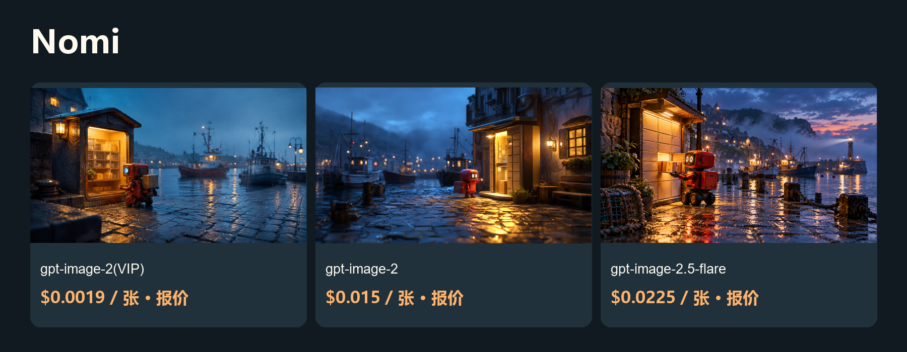

# 更低成本的 Nomi 图片与视频方案

本地分镜、模型接入与视频时间轴。

[English](README.md) · [Model & pricing](https://go2v.toapis.com/1020_nm_g) · [Upstream](https://github.com/aqm857886159/Nomi)

**ToAPIs独立社区方案，非上游官方版本。** 本轮验证API、配置契约或局部Adapter，完整产品流程尚未验收。

## 演示



[](examples/seedance-2-mini.mp4)

[▶ 查看真实视频](examples/seedance-2-mini.mp4)

视频参数：seedance-2-mini · 480p · 4s requested / 4.04s decoded · 16:9 · generate_audio=false · first-frame I2V.

视频实际消费：$0.13338 / clip · $0.03301485148514851485148514851/s (this case).

## 本例花费与模型价格（升序）

2026-10-20.

| 模型／档位 | 类型 | 本例金额／报价 | 对应模型价格 | 费用依据 |
|---|---|---:|---|---|
| gpt-image-2(VIP)<br>low / 1K | 图片 | 报价 $0.0019 | $0.0019/image | 档位报价；单任务未返回结算 |
| gpt-image-2<br>1K | 图片 | 报价 $0.015 | $0.015/image | 档位报价；单任务未返回结算 |
| gpt-image-2.5-flare<br>high / 1K | 图片 | 报价 $0.0225 | $0.0225/image | 档位报价；单任务未返回结算 |
| seedance-2-mini<br>480p / 4.04s / 无声 | 视频 | $0.13338 | $3.285714/1M total tokens | API billing=settled |

gpt-image-2(VIP)通用价格为$0.0019/image起；本例low/1K为$0.0019/image。图片按当期同Key档位报价标识，未把缺失回执写成实扣。三模型使用本项目相同提示词，但质量档位不同，不能视为同等质量比较。视频美元/秒是本例折算，不是固定秒价。

## 对应项目的复用方法

1. 通过正常“模型接入”界面创建ToAPIs连接：地址https://toapis.com、Bearer鉴权，私有Key在界面配置。
2. 通过支持的Agent/UI说明卡路径提交integration/nomi-supplied-contract.json；供应商身份由Nomi提供，不旁路写catalog.json或凭据。
3. 外部说明卡与完整草稿已通过固定SHA的原生校验器，覆盖3个图片模型及1个首帧视频模型。这是结构/语义校验，尚非桌面认证。
4. 本地首帧按上传声明转成URL，再走明确的异步提交/查询映射。完成原生认证及真实画布任务后再标为生产可用。

## 运行独立API案例

```powershell
$env:TOAPIS_API_KEY="your_private_key"
python run_case.py --job jobs/gpt-image-2-vip.json
python run_case.py --job jobs/gpt-image-2-vip.json --live
python run_case.py --job jobs/video.json
python run_case.py --job jobs/video.json --live
```

不加--live仅查当前Key价格。先在本地设置预算；脚本提供单任务限额，不代表托管账户全局消费限制。失败或超时先查保存的原任务，不重复提交。

## 可选同步桥接

```powershell
$env:BRIDGE_TOKEN="replace_with_a_separate_random_token_at_least_24_chars"
$env:BRIDGE_PORT="8769"
python bridge.py
```

只监听127.0.0.1；界面填独立桥接Token，不填写真实ToAPIs Key。不改变上游SSRF/出站策略，不用于公共托管服务。图片仅文生图；视频桥只支持明确的首帧、尺寸与4秒档位。

## 原创输入与输出

```text
An original cinematic storyboard still: a tiny red courier robot stands beside a warm illuminated parcel kiosk at a rainy harbor at blue hour, polished cobblestone reflections, distant fishing boats, gentle mist, hopeful atmosphere, tactile miniature film set, clear single composition, 16:9 landscape, no text, no logos, no watermark.
```

[Jobs](jobs/) · [Original media](examples/) · [Sanitized evidence](evidence/) · [Acceptance](ACCEPTANCE.md) · [Upstream and protocol evidence](UPSTREAM.md)

## 许可与边界

Original guide/adapter code: MIT. Upstream source and trademarks keep their own license and ownership. The OpenShorts fork retains its upstream MIT license. No existing sponsor/referral links were replaced. No audio integration claim is made.

<!-- extra-video-models -->

## 补充：Seedance 2.5、MiniMax-H3、Kling

| 模型 | 请求 | 实际时长 | API确认消费 | 本例美元/秒 | 当前档位价格 |
|---|---|---:|---:|---:|---|
| kling-3.0-turbo | 4s / 720p | 4.04s | $0.32 | $0.079208/s | $0.08/s |
| MiniMax-H3 | 5s / 768p | 5.17s | $0.32 | $0.061896/s | $0.064/s |
| seedance-2-5 | 4s / 480p | 4.04s | $0.3883 | $0.096114/s | $10/1M total tokens |

[Full videos, prompt and script](video-comparison/README_zh-CN.md)


以上为独立API文生视频案例，非Nomi原生界面验收。分辨率与时长不同，费用按本例结算；NovaNova旧任务仍待核对。
